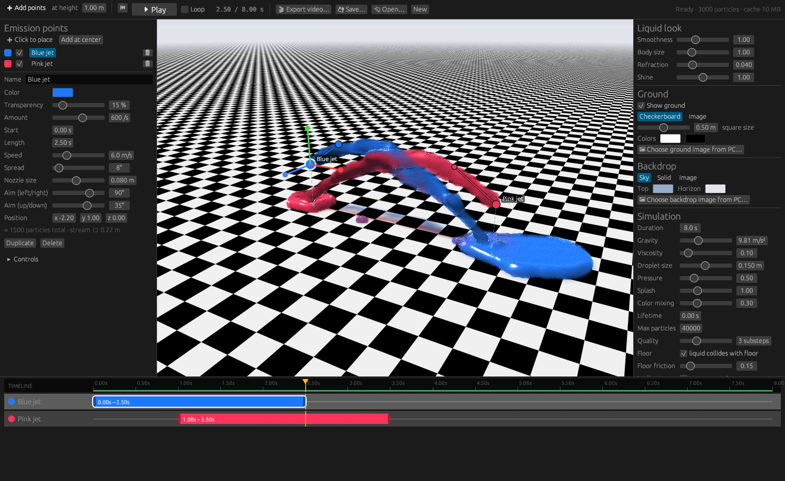

# FluidStudio

A desktop fluid simulation studio written in Rust. Place emission points in a 3D scene, time them on a timeline, press Play, and export the result as a video.



## Download

Get the latest `FluidStudio-…-win64.zip` from the [Releases page](https://github.com/toasty-wheeler/FluidStudio/releases/latest). Unzip it anywhere and run `FluidStudio.exe`. There's no installer, and ffmpeg is included for video export.

## Features

- **3D scene editing:** click the floor to place emission points, drag them to move them, and drag the arrow tip to aim.
- **Per-point settings:** amount, length, start time, speed, spread, nozzle size, color and transparency.
- **Timeline:** drag bars to choose when each point fires, and drag the bar ends to change how long it fires.
- **Liquid rendering:** a screen-space fluid surface with refraction, reflections, absorption and colored shadows. Touching fluids blend their colors.
- **Ground and backdrop:** the ground is a checkerboard or any image (tiled, or one centered image the liquid can pour off). The backdrop is a sky gradient, a solid color or an image.
- **Export:** MP4, WebM or MOV (with transparency), or a PNG sequence, using the same GPU renderer as the viewport.
- **Portable:** settings, projects, imported images and exports are all stored in the program's own folder.

## Building

Requires Rust (stable) on Windows with the MSVC toolchain.

```
cargo build --release
```

The program is `target/release/fluid-studio.exe`.

## Video export

[ffmpeg](https://ffmpeg.org/) is included in the release zip, so video export works out of the box. It's an unmodified GPL build from [BtbN/FFmpeg-Builds](https://github.com/BtbN/FFmpeg-Builds); its license and source details are in the `licenses` folder.

## Controls

| Action | Input |
| --- | --- |
| Orbit camera | Left-drag |
| Pan | Right-drag or Shift + drag |
| Zoom | Mouse wheel |
| Play / pause | Space |
| Toggle add-point mode | A |
| Delete selected point | Del |
| Duplicate selected point | Ctrl + D |
| Save project | Ctrl + S |
| Free (unsnapped) timeline drag | Hold Shift |

## License

FluidStudio is released under the [MIT License](LICENSE). The bundled ffmpeg has its own license (GPLv3); see the `licenses` folder in the release.
